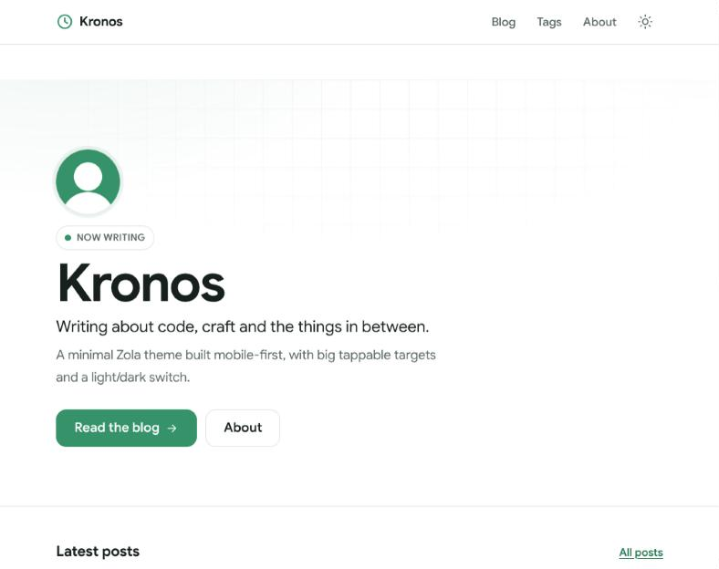

# Kronos

A minimal, mobile-first blog theme for [Zola](https://www.getzola.org).



- **Eye-catching home page** — a hero with a soft brand-coloured wash and faint
  grid, followed by the latest posts and a tag cloud.
- **Mobile-first and thumb-friendly** — 17px body text on phones, and every
  link, button and menu item is at least 44px tall (52px for the primary ones).
  Post rows are a single large tap target rather than a small title link.
- **Light and dark** — light is the default. The switch is remembered in
  `localStorage` and applied before first paint, so there is no flash of the
  wrong colours. Code highlighting follows the active mode.
- **Primary colour `#369369`**, exposed as CSS custom properties so you can
  restyle without touching Sass.
- No build step, no dependencies, ~1KB of JavaScript.

Requires Zola **0.22.0** or newer.

## Installation

```bash
cd my-site
git submodule add https://github.com/vermaneerajin/zola-kronos.git themes/zola-kronos
git submodule update --init --recursive
```

If you would rather not use submodules, clone it instead:

```bash
git clone https://github.com/vermaneerajin/zola-kronos.git themes/zola-kronos
```

Then in `config.toml`:

```toml
theme = "zola-kronos"
compile_sass = true

taxonomies = [
  { name = "tags", feed = true, paginate_by = 10 },
]

[markdown.highlighting]
style = "class"
light_theme = "github-light"
dark_theme = "github-dark"
add_color_scheme = false
```

The `[markdown.highlighting]` block is what makes code blocks follow the
light/dark switch. Zola writes `giallo-light.css` and `giallo-dark.css`, which
the theme links and swaps on toggle. Skip the block if you do not want
highlighted code.

## Content structure

Kronos expects posts in a section, `content/blog/` by default:

```
content/
├── _index.md          # home page (the hero is rendered from config)
├── about.md
└── blog/
    ├── _index.md      # sort_by = "date", paginate_by = 10
    └── my-post.md
```

`content/blog/_index.md`:

```toml
+++
title = "Blog"
description = "Everything published so far, newest first."
sort_by = "date"
paginate_by = 10
template = "section.html"
page_template = "page.html"
+++
```

Point `kronos_home_section` elsewhere if your posts live somewhere else. If the
section does not exist, the home page falls back to the pages in `content/`.

## Options

All options live under `[extra]` and all of them have defaults — the theme
works with an empty `[extra]` table.

| Key | Default | What it does |
| --- | --- | --- |
| `kronos_hero_title` | `config.title` | Big headline on the home page. Inline HTML is allowed; wrap words in `<em>` to paint them in the brand colour. |
| `kronos_eyebrow` | `"Now writing"` | Small pill above the headline. |
| `kronos_tagline` | — | One-line statement under the headline. |
| `kronos_intro` | — | Short paragraph under the tagline. |
| `kronos_cta_text` / `kronos_cta_url` | — | Primary hero button. Omitted if the text is empty. |
| `kronos_cta2_text` / `kronos_cta2_url` | — | Secondary hero button. |
| `kronos_avatar` | — | Path under `static/` to a round avatar in the hero. |
| `kronos_home_section` | `"blog/_index.md"` | Section the home page lists from. |
| `kronos_home_posts` | `5` | How many posts the home page lists. |
| `kronos_home_tags` | `true` | Show the tag cloud on the home page. |
| `kronos_show_reading_time` | `true` | Show "N min read" on posts. |
| `kronos_show_toc` | `false` | Show a collapsible table of contents on posts with headings. |
| `kronos_respect_os_theme` | `false` | When `true`, first-time visitors get dark mode if their OS asks for it. Light stays the default otherwise. |
| `kronos_author` | `config.title` | Name in the footer and in the post metadata. |

### Menu

```toml
[[extra.kronos_menu]]
name = "Blog"
url = "/blog/"
```

### Social links

Add one `[[extra.kronos_social]]` block per link — as many as you like. They
render as a row of icon buttons in the footer, wrapping onto more rows on
narrow screens, each one a 48px tap target.

```toml
[[extra.kronos_social]]
icon = "github"
name = "GitHub"                      # accessible label; optional
url = "https://github.com/yourname"

[[extra.kronos_social]]
icon = "devto"
name = "DEV"
url = "https://dev.to/yourname"

[[extra.kronos_social]]
icon = "email"
url = "mailto:you@example.com"
```

`name` is used for the `aria-label`, the tooltip and screen-reader text. If you
leave it out it falls back to the capitalised icon key.

Built-in `icon` values:

| | | | |
| --- | --- | --- | --- |
| `github` | `gitlab` | `codeberg` | `stackoverflow` |
| `devto` | `hashnode` | `medium` | `substack` |
| `mastodon` | `bluesky` | `x` | `threads` |
| `linkedin` | `facebook` | `instagram` | `youtube` |
| `twitch` | `telegram` | `discord` | `reddit` |
| `hackernews` | `email` | `rss` | `website` |

Any other value falls back to a generic link icon, so an unlisted service still
renders sensibly:

```toml
[[extra.kronos_social]]
icon = "goodreads"      # not built in — shows the generic link icon
name = "Goodreads"
url = "https://www.goodreads.com/yourname"
```

To add a real icon for it, override `templates/macros.html` in your own site and
add a branch to the `icon` macro. Icons are 24x24 inline SVG drawn in a 1.75
stroke weight with `currentColor`, so they inherit the theme automatically.

### Avatar

`kronos_avatar` is a path under `static/`. The image is cropped to a circle
(`object-fit: cover`, so it does not matter if the source is not square),
sized 4.5rem on phones and 5.5rem from the tablet breakpoint, and given a soft
brand-coloured ring. It sits on its own line above the eyebrow pill, left
aligned with the rest of the hero.

```toml
kronos_avatar = "images/avatar.png"
```

Leave it as `""` to hide it.

### Per-post front matter

```toml
+++
title = "Hello, Kronos"
date = 2026-10-15
description = "Shown in the post list and in link previews."
[taxonomies]
tags = ["meta"]

[extra]
author = "Someone Else"   # optional, overrides the byline
+++
```

## Shortcodes

- `{{/* note(title="Heads up") */}} … {{/* end */}}` — a callout box.
- `{{/* figure(src="/images/x.png", alt="…", caption="…") */}}` — image with a caption.

## Customising

Override any template by copying it into your site's own `templates/`
directory — Zola prefers yours over the theme's. For colours, redefine the
custom properties after the theme stylesheet:

```css
:root { --primary: #7c3aed; --primary-hover: #6d28d9; }
:root[data-theme="dark"] { --primary: #a78bfa; }
```

Blocks available in `base.html`: `title`, `head_extra`, `main`, `content`,
`body_extra`.

## Development

```bash
zola serve
```

The repository doubles as a demo site: `config.toml` and `content/` at the root
are the example, and the theme itself is `templates/`, `sass/`, `static/` and
`theme.toml`.

## Author

By [Neeraj Verma](https://github.com/vermaneerajin).

## Deploying

The repository ships a GitHub Actions workflow
([`.github/workflows/pages.yml`](.github/workflows/pages.yml)) that builds the
demo and publishes it to GitHub Pages on every push to `main`.

To turn it on, set **Settings → Pages → Build and deployment → Source** to
**GitHub Actions** once. No `gh-pages` branch and no deploy key are needed —
the workflow uses the built-in `GITHUB_TOKEN`.

It builds with `--base-url` taken from the Pages configuration, so the same
workflow works whether the site is served from the domain root or from a
`/<repo>/` sub-path. All configured menu, call-to-action and social URLs are
resolved through Zola's `get_url()`, so relative paths like `/blog/` stay
correct under a sub-path.

The pinned Zola version lives in the `ZOLA_VERSION` env var at the top of the
workflow.

## License

MIT — see [LICENSE](LICENSE).
